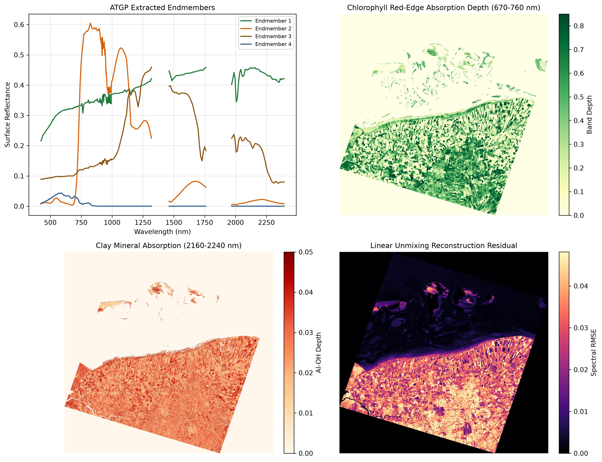
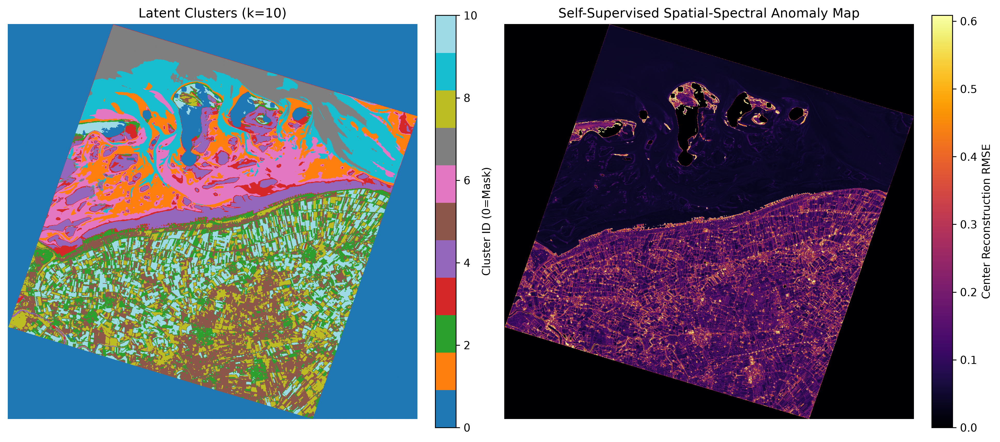
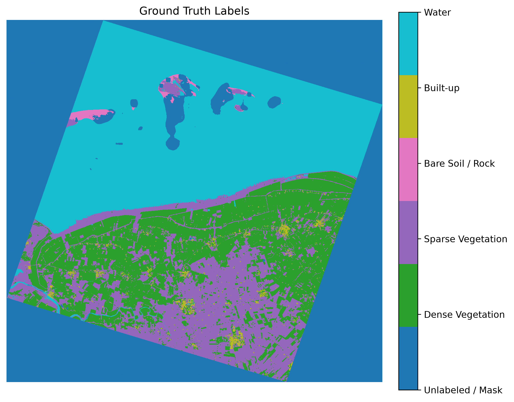
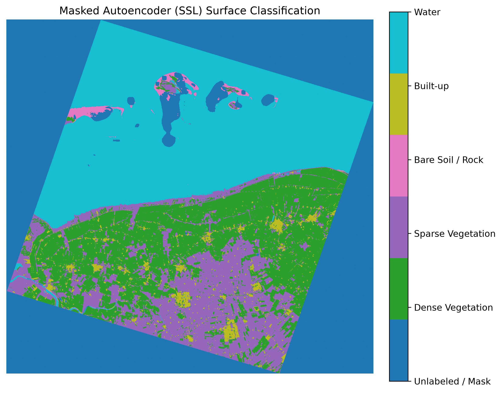

[](https://github.com/drice987/hsi_classification/actions/workflows/tests.yml)

# Hyperspectral Imaging Spectroscopy & Self-Supervised Learning (`hsi`)

## Overview
Spaceborne and airborne imaging spectrometers record contiguous reflectance spectra across hundreds of narrow wavelength channels, capturing electronic transitions in the visible/near-infrared (VNIR) alongside vibrational overtone and combination bands in the shortwave infrared (SWIR). Working with operational hyperspectral acquisitions presents three recurring practical challenges:
1. **Sensor Geometry & Radiometric Artifacts:** Spaceborne Level-2A products (such as DLR EnMAP scenes) sit on rotated UTM swath grids with nodata margins, overlapping VNIR/SWIR focal-plane arrays, LZW quality bitmasks, and opaque atmospheric water-vapor absorption windows.
2. **Scarce Ground-Truth Reference Data:** Operational satellite tiles rarely ship with pixel-level land-cover labels, requiring either physical parameter inversions, self-supervised representation learning, or automated alignment with external reference rasters.
3. **Spatial Autocorrelation in Patch Models:** Convolutional receptive fields easily leak neighboring pixels across random train/test splits, inflating validation metrics while failing to generalize across spatially distinct regions.

`hsi` is a modular Python framework combining **physical VNIR–SWIR reflectance spectroscopy** with **self-supervised spatial-spectral deep learning**. It supports memory-mapped EnMAP Level-2A products and airborne benchmark cubes (Pavia University), providing upper convex-hull continuum removal, autonomous linear unmixing, multi-mission bandpass simulation, cloud-native ESA WorldCover label alignment, and masked convolutional autoencoders.

## Key Features

- **EnMAP Level-2A Ingestion & Georeferenced I/O (`hsi.enmap`, `hsi.data_loader`):**
  - Memory-mapped reading of ENVI `.BSQ`/`.HDR` and GeoTIFF spectral cubes with spatial bounding-box cropping (`--bbox`) and automatic affine tiepoint translation (`GeoMetadata.crop`).
  - Automated parsing of `METADATA.XML` band characterization tables (wavelength centers, FWHM, radiometric gains, and offsets).
  - Monotonic splicing of the overlapping VNIR ($420\text{--}993\text{ nm}$) and SWIR ($902\text{--}2450\text{ nm}$) detector arrays at $950\text{ nm}$ and exclusion of deep $\text{H}_2\text{O}$ absorption windows ($1350\text{--}1460\text{ nm}$ and $1790\text{--}1960\text{ nm}$).
  - Screening of cloud, cloud-shadow, haze, cirrus, and snow quality bitmasks, plus multi-band Level-2B GeoTIFF export (`export_geotiff`) preserving EPSG coordinate reference tags.
- **Cloud-Native ESA WorldCover Alignment (`hsi.fetch_worldcover`):**
  - Streams intersecting 10 m ESA WorldCover Cloud-Optimized GeoTIFFs (COGs) directly from AWS S3 via `/vsicurl/` without downloading full global tiles.
  - Reprojects and aggregates 10 m land-cover classes onto the exact 30 m UTM grid and spatial extent of any target EnMAP scene using mode resampling.
- **Quantitative VNIR–SWIR Absorption Spectroscopy (`hsi.spectral_analysis`):**
  - **Upper Convex-Hull Continuum Removal:** Normalizes diagnostic absorption troughs against a piecewise-linear upper convex hull anchored at window shoulder maxima ($R(\lambda) / R_c(\lambda)$).
  - **Sub-Band Parabolic Interpolation:** Fits a 3-point parabolic vertex around discrete band extrema to resolve continuous absorption minimum wavelengths ($\lambda_{\min}$) and Red-Edge Inflection Point (REIP) derivative maxima below the native $\sim 10\text{ nm}$ SWIR sampling interval.
  - **Diagnostic Windows:** Configured for Chlorophyll Red-Edge ($670\text{--}760\text{ nm}$), NIR Liquid Water ($920\text{--}1020\text{ nm}$), Cellulose/Lignin ($2030\text{--}2140\text{ nm}$), Phyllosilicate Clay $\text{Al-OH}$ ($2160\text{--}2240\text{ nm}$), and Carbonate ($2280\text{--}2360\text{ nm}$).
  - **Monte Carlo SNR Error Propagation:** Quantifies sub-band wavelength and band-depth retrieval RMSE across realistic instrument signal-to-noise ratios ($50:1$ to $800:1$).
- **Autonomous Endmember Extraction & Linear Unmixing:**
  - Extracts pure spectral endmembers via L2-shape-normalized Orthogonal Subspace Projection (ATGP) so bright sand or clouds do not dominate selection over dark water or soil spectra.
  - Solves shade-normalized or sum-to-one constrained (`fcls_weight`) Non-Negative Least Squares (NNLS) to map fractional abundances and per-pixel reconstruction RMSE.
- **Cross-Mission Bandpass Simulation:**
  - Convolves hyperspectral cubes through Gaussian Spectral Response Functions (SRFs) for **Sentinel-2 MSI**, **Sentinel-3 OLCI**, **EUMETSAT EPS-SG METimage**, and **MTG FCI** to benchmark multi-sensor parameter retrieval.
- **Self-Supervised Spatial-Spectral Learning (`hsi.model`, `hsi.pretrain_ssl`, `hsi.cluster`, `hsi.finetune`):**
  - `MaskedConvolutionalAutoencoder` pairs a $1\times 1$ spectral bottleneck (`C -> 64`) with $3\times 3$ spatial convolutions and a learnable spatial `mask_token`, trained via stochastic patch sampling (`RandomSpatialPatchDataset`).
  - **Contextual Anomaly Detection & Latent Clustering:** Evaluates center-pixel reconstruction RMSE and extracts center-coordinate latent embeddings for `MiniBatchKMeans` segmentation, preserving sharp agricultural parcel boundaries.
  - **Albedo-Stratified Few-Shot Fine-Tuning:** Subsamples training shots stratified across within-class NIR reflectance distributions (`apply_stratified_few_shot_split`) to capture bright and dark material endmembers (e.g., quartz dune sand vs. wet tidal flats) before two-stage differential learning rate fine-tuning.

## Example Outputs (EnMAP Level-2A Coastal & Agricultural Scene)

<p align="center">
  
</p>

*Physical spectroscopy pipeline on an EnMAP L2A scene (Groningen / Wadden Sea): shape-normalized ATGP endmembers with convolved Sentinel-2 MSI bandpasses (top-left), continuum-removed chlorophyll red-edge depth (top-right), SWIR Al–OH clay mineral absorption depth at 2200 nm (bottom-left), and NNLS unmixing residual RMSE (bottom-right).*

<p align="center">
  
</p>

*Self-supervised spatial-spectral pipeline on the same unlabeled EnMAP scene: center-pixel latent K-Means clustering ($k=10$, left) and contextual reconstruction RMSE anomaly map (right).*

### Downstream Few-Shot Transfer Learning (ESA WorldCover 10m Alignment)

| Reference Labels (ESA WorldCover Reprojected to 30 m) | SSL Fine-Tuned Prediction (200 Shots / Class) |
| :---: | :---: |
|  |  |

*Evaluation of few-shot transfer learning: 10 m ESA WorldCover reference labels aggregated to the EnMAP 30 m UTM grid (left) versus the downstream classification map produced by fine-tuning the pretrained masked autoencoder with 200 shots per class (right).*

## Requirements & Installation

Requires **Python 3.11+**.

```bash
git clone https://github.com/drice987/hsi_classification.git
cd hsi_classification

python3 -m venv .venv
source .venv/bin/activate

pip install -e ".[test]"
```

### Core Dependencies

- `numpy`, `scipy`, `scikit-learn`
- `torch`
- `tifffile`, `imagecodecs`, `rasterio`
- `matplotlib`

## Quick Start
All CLI modules accept either a path to an EnMAP Level-2A product directory or the Pavia University `.mat` file, along with an optional `--bbox R0 R1 C0 C1` spatial crop.

### 1. VNIR-SWIR Continuum Spectroscopy, Unmixing and Cross-Mission Simulation
```bash
# Run continuum removal, ATGP unmixing, SNR check, Sentinel-2 simulation, and GeoTIFF export
python -m hsi.spectral_analysis data/enmap_sample \
    --convolve s2 \
    --snr-check \
    --export-tif outputs/enmap_l2b_metrics.tif \
    --out outputs/enmap_spectroscopy_summary.png

# Simulate EUMETSAT EPS-SG METimage or MTG FCI bandpasses on a spatial subset
python -m hsi.spectral_analysis data/enmap_sample --bbox 400 800 400 800 --convolve metimage
```
### 2. Self-Supervised Pretraining, Clustering, and Anomaly Mapping
```bash
# Pretrain the masked spatial-spectral autoencoder via random patch sampling
python -m hsi.pretrain_ssl data/enmap_sample \
    --epochs 40 \
    --samples-per-epoch 40000 \
    --out outputs/enmap_ssl_full.pth

# Extract center-pixel latent K-Means clusters and contextual reconstruction anomaly map
python -m hsi.cluster data/enmap_sample \
    --weights outputs/enmap_ssl_full.pth \
    --clusters 10 \
    --out outputs/ssl_clusters_anomalies_10.png
```

### 3. Cloud-Native WorldCover Alignment and Few-Shot Fine-Tuning
```bash
# Stream and reproject 10 m ESA WorldCover COGs onto the 30 m EnMAP scene grid
python -m hsi.fetch_worldcover data/enmap_sample --out data/aligned_worldcover.tif

# Fine-tune the pretrained encoder using albedo-stratified few-shot sampling
python -m hsi.finetune data/enmap_sample \
    --gt-tif data/aligned_worldcover.tif \
    --shots 200 \
    --pretrained outputs/enmap_ssl_full.pth \
    --weights outputs/finetuned_stratified.pth

# Generate full-scene classification map
python -m hsi.predict data/enmap_sample \
    --weights outputs/finetuned_stratified.pth \
    --out outputs/ssl_full_prediction_map.png
```

### 4. Unified Figure Generation and Supervised Baselines
```bash
# Render overview, spectroscopy, clustering, and prediction figures in one pass
python -m hsi.visualization data/enmap_sample --mode all --convolve s2

# Evaluate PCA + Random Forest baseline under random vs. 75/25 spatial column split
python -m hsi.baseline data/PaviaU.mat

# Train supervised 2D Spatial-Spectral CNN with a receptive-field dead-zone buffer
python -m hsi.train data/PaviaU.mat --epochs 15
```

## Module Overview
| Module | Description |
| :--- | :--- |
| `hsi.enmap` | Memory-mapped EnMAP L2A `.BSQ`/GeoTIFF ingestion, `METADATA.XML` calibration, VNIR/SWIR overlap splicing, quality bitmasking, and GeoTIFF L2B export. |
| `hsi.fetch_worldcover` | Cloud-native /vsicurl/ streaming and mode-resampled UTM reprojection of 10 m ESA WorldCover tiles onto EnMAP grids. |
| `hsi.spectral_analysis` | Upper convex-hull continuum removal, 3-point parabolic sub-band interpolation, ATGP/NNLS unmixing, Monte Carlo SNR analysis, and S2/S3/METimage/FCI SRF convolution. |
| `hsi.model` | `MaskedConvolutionalAutoencoder`, `SSLClassifier`, and `SpatialSpectralCNN`. |
| `hsi.dataset` | `RandomSpatialPatchDataset`, `SpatialPatchDataset`, `SSLNeighborhoodDataset` (with binary mask erosion), and zero-copy `PixelInferenceDataset`. |
| `hsi.pretrain_ssl` | Self-supervised pretraining loop over valid scene pixels. |
| `hsi.cluster` | Center-coordinate latent K-Means clustering and contextual reconstruction RMSE anomaly mapping. |
| `hsi.finetune` | Albedo-stratified few-shot splitting and two-stage encoder/head fine-tuning. |
| `hsi.visualization` | Plotting routines for false-color composites, class signatures, continuum spectroscopy, and SSL maps. |